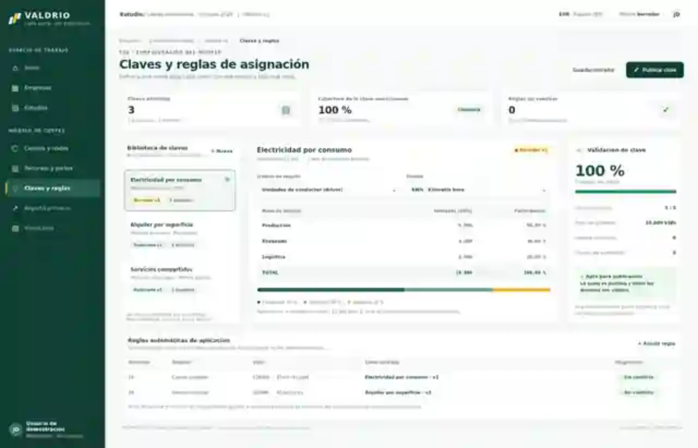

# VALDRIO — Sistema visual obligatorio de la aplicación (v1.0)

**Aprobación del propietario:** 2026-10-08. **Ámbito:** TODA la interfaz de VALDRIO (WPF/XAML, ventanas, diálogos, formularios, tablas, asistentes y futuras pantallas). **Estado:** directriz de diseño aprobada; **no** implica que la aplicación ya haya sido migrada.

> **Regla prioritaria:** La pantalla de **«T08 / Claves y reglas de asignación»** suministrada por el propietario el 08/10/2026 define la **estética y estructura visual objetivo** de toda VALDRIO. Se replica su lenguaje de diseño, no sus datos ficticios ni la funcionalidad específica de T08. No es una captura de funcionalidad implementada. Se conserva la funcionalidad real de cada módulo.

## 1. Referencia visual principal

[Ver referencia visual ampliada](referencias/VALDRIO_T08_REFERENCIA.svg).

**Orden de autoridad en UI:** (1) funcionalidad y requisitos de seguridad, accesibilidad e internacionalización existentes; (2) **esta guía y la imagen aprobada** para lenguaje visual; (3) manual de marca VALDRIO v1 para identidad/logo/colores; (4) implementaciones visuales anteriores. Un conflicto funcional se eleva, no se resuelve quitando acciones. La anterior recomendación genérica de azules/pasteles ya **no** es el objetivo visual.

## 2. Aspecto visual innegociable

- **Identidad:** producto de escritorio profesional para controlling/costes, sobrio, limpio y estructurado. Predominan **verde profundo**, **blanco**, **neutros luminosos**, con **amarillo** como acento y **rojo** para error o destrucción. **No usar azul** como color principal de navegación, botones o selección.
- **Shell común:** barra lateral izquierda en verde profundo con logotipo/claim arriba, navegación agrupada con títulos discretos y elemento activo en verde medio con **marca amarilla** lateral; zona de trabajo clara y barra superior blanca de contexto (estudio/empresa, periodo, modelo, preferencias, usuario).
- **Cabecera de cada pantalla:** breadcrumbs discretos; sobretítulo de módulo/fase opcional; título contundente en verde oscuro; texto explicativo breve; acciones principales alineadas a la derecha. El contexto se muestra sin exponer IDs técnicos innecesarios.
- **Superficies:** fondo de trabajo gris muy claro verdoso; tarjetas blancas con borde gris-verde sutil, radio moderado y separación visible; sombras imperceptibles o ausentes. Evitar gradientes decorativos, vidrio, efectos 3D y bloques cromáticos grandes fuera de la navegación.
- **Información:** primera fila de KPIs cuando aporten valor, después paneles maestro/detalle, resumen lateral contextual o formularios/tablas según la tarea. Bloque inferior para reglas, historial o información secundaria si procede; no añadir secciones ficticias para imitar la imagen.
- **Densidad:** diseño compacto pero cómodo para escritorio. Alto contraste y jerarquía clara; títulos cortos, etiquetas y ayuda funcional, importes/tablas numéricas alineados a la derecha.

## 3. Tokens de diseño aprobados

Los colores de marca **exactos** vienen del Manual de Marca v1; los tokens neutros y de estado adicionales son una **propuesta operativa derivada de la referencia**, a centralizar en el tema WPF y ajustar solo tras revisión visual.

| Token semántico | Hex | Uso |
|---|---|---|
| Brand.DeepGreen | **#123F35** | Sidebar, botón principal, encabezados relevantes |
| Brand.Yellow | **#E8B931** | Acento de selección, prioridades y avisos; texto oscuro |
| Brand.Red | **#B73536** | Error/destructivo; no decoración |
| Brand.White | **#FFFFFF** | Tarjetas y barra superior |
| Surface.Canvas | **#F5F8F6** | Fondo principal |
| Surface.Subtle | **#EFF5F1** | Filas seleccionadas, bloques suaves, cabeceras de tabla |
| Border.Soft | **#DBE4DF** | Bordes y divisores |
| Text.Primary | **#213C34** | Texto principal |
| Text.Secondary | **#788D85** | Metadatos, ayudas, etiquetas secundarias |
| Accent.ActiveGreen | **#266756** | Selección en navegación, realce secundario |
| Status.Success | **#23875A** | Estado positivo (siempre con texto/icono) |
| Status.SuccessBg | **#EAF6EE** | Fondo suave de éxito |
| Status.WarningBg | **#FFF5D6** | Borrador/atención, con texto oscuro |
| Status.ErrorBg | **#FBEAEA** | Error contextual |

**Reglas:** usar tokens semánticos, no códigos hex sueltos por ventana; comprobar contraste WCAG AA en tamaño real. Texto blanco sobre verde profundo; texto verde profundo sobre amarillo; no blanco sobre amarillo. El estado no se indica nunca solo por color.

## 4. Geometría, tipografía y componentes

- **Base espacial:** escala de 4/8 px; márgenes de pantalla orientativos 24–32 px; separación entre tarjetas 12–16 px; paddings interiores 16–24 px. Ajustar con escalado/DPI, no reproducir píxeles ciegamente.
- **Composición de escritorio:** navegación lateral persistente ~220–240 px *orientativos*; topbar ~56–64 px; contenido con scroll y grids flexibles; sin solapamientos a 125 %, 150 % y 200 % de escala. Cuando falte ancho, reordenar paneles o dar scroll, nunca cortar acciones.
- **Tipografía:** DejaVu Sans según manual de marca, si está disponible/licenciada en producto; fallback de sistema de buena legibilidad (p. ej. Segoe UI). Títulos 24–28 px, paneles 15–18 px, cuerpo 12–14 px *orientativos* y escala coherente; números tabulares o monoespaciados donde convenga.
- **Tarjetas KPI:** etiqueta pequeña, cifra prominente, subtítulo/estado contextual; solo si el dato existe. No inventar métricas.
- **Botones:** primario sólido verde profundo con texto blanco; secundario blanco con borde; terciario textual; destructivo rojo con confirmación cuando proceda. «Guardar borrador» y «Publicar» deben distinguirse visualmente y semánticamente.
- **Inputs y selectores:** fondo blanco, borde fino, foco perceptible, etiquetas visibles, validación junto al campo. Tooltips no sustituyen instrucciones esenciales.
- **Tablas:** cabecera de fondo neutro; filas con separadores sutiles; total/resumen ligeramente resaltado; unidades, precisión y moneda explícitas; cantidades a la derecha; navegación y selección por teclado.
- **Badges de estado:** ligeros y consistentes (borrador amarillo claro, publicado/válido verde claro, error rojo claro), **siempre con palabra de estado**; no confundir borrador de una clave con borrador del modelo/estudio.
- **Iconos:** lineales sencillos de trazo consistente y acompañados por texto en acciones importantes. No usar emoji como iconografía de producto.

## 5. Plantilla estructural para cualquier vista

1. **Shell** compartido: identidad/navegación/contexto/prefs del usuario.
2. **Ruta + cabecera:** «dónde estoy», «qué hago» y acciones esenciales.
3. **Resumen** *solo cuando ayude*: KPIs o estado/preparación de la tarea.
4. **Zona de trabajo** con paneles y controles que reflejen el flujo real: lista + detalle, formulario, tabla, wizard, importación o resultados; no forzar tres columnas en todas las pantallas.
5. **Validación y diagnóstico** visibles junto a la operación, sin esconder errores ni bloquear sin explicación.
6. **Historial/acciones secundarias** cuando proceda, diferenciados del flujo principal.

La captura T08 ilustra **biblioteca de claves → definición y pesos → comprobación → reglas automáticas**. Para Empresa, Centros y nodos, Recursos y partes, Estudios, Importación, Reparto y Resultados se adopta **el mismo shell, tokens, componentes y jerarquía**, pero se mantienen **sus propios flujos reales**.

## 6. Aplicación técnica (WPF / XAML / XML)

**En este paso no se modifica ninguna pantalla ni lógica.** En la fase de implementación:

1. Auditar vistas y funcionalidades reales de cada pantalla.
2. Crear/actualizar un **ResourceDictionary** de tema global con `SolidColorBrush`, tamaños, espaciado, tipografía y estilos reutilizables de `Button`, `TextBox`, `ComboBox`, `DataGrid`, `TabControl`, tarjetas, sidebar, badge y panel de diagnóstico. Usar `StaticResource`/`DynamicResource` según proceda.
3. Reutilizar componentes/estilos: no copiar colores, márgenes y plantillas entre archivos `.xaml` o XML. Documentar variantes justificadas.
4. Migrar progresivamente todas las vistas (principal, Empresa, Modelo, Estudios, Importación, diálogos y etapas posteriores) manteniendo navegación, comandos, bindings, validaciones, accesos y persistencia **1:1**.
5. Conservar ES/EN, moneda/locale/zona independientes, truncamientos, foco visible, tabulación, escalado DPI y estados vacíos/error/carga/solo lectura.
6. Contrastar capturas reales WPF con la imagen normativa y con una matriz de funciones anterior/después; **la maqueta de T08 no es evidencia de software ya implementado**.

## 7. Checklist obligatorio de revisión frontend

- [ ] Leí `AGENTS.md`, este documento y la referencia visual antes de tocar XAML/XML.
- [ ] La pantalla conserva todas sus funciones, permisos, bindings, comandos y navegación real.
- [ ] El shell, los colores, la jerarquía y los componentes siguen esta guía; sin nuevas paletas ad hoc ni azules principales.
- [ ] Guardar, cancelar, publicar, validar, errores y estados no se pierden ni se confunden.
- [ ] Se han probado pantallas reales con datos, vacíos, errores, ES/EN y DPI.
- [ ] El cambio aporta capturas de antes/después y diferencias funcionales expresas (si existen).
- [ ] No se ejecutó GitHub Actions facturable sin aprobación expresa.

**Gobierno:** toda desviación global de tokens, shell, patrones y estilo requiere aprobación explícita del propietario y versión nueva de esta guía. Una pantalla aislada no redefine la estética de VALDRIO.
