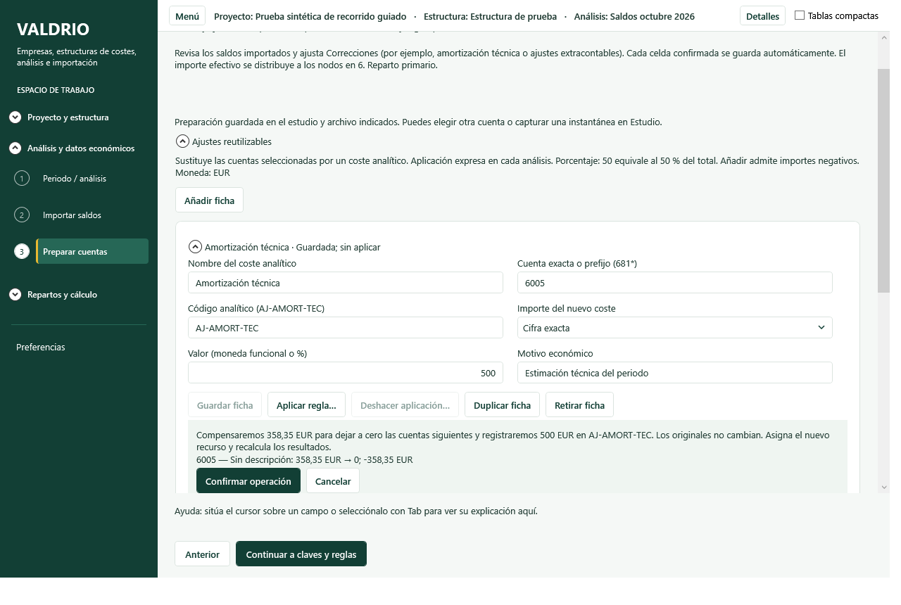
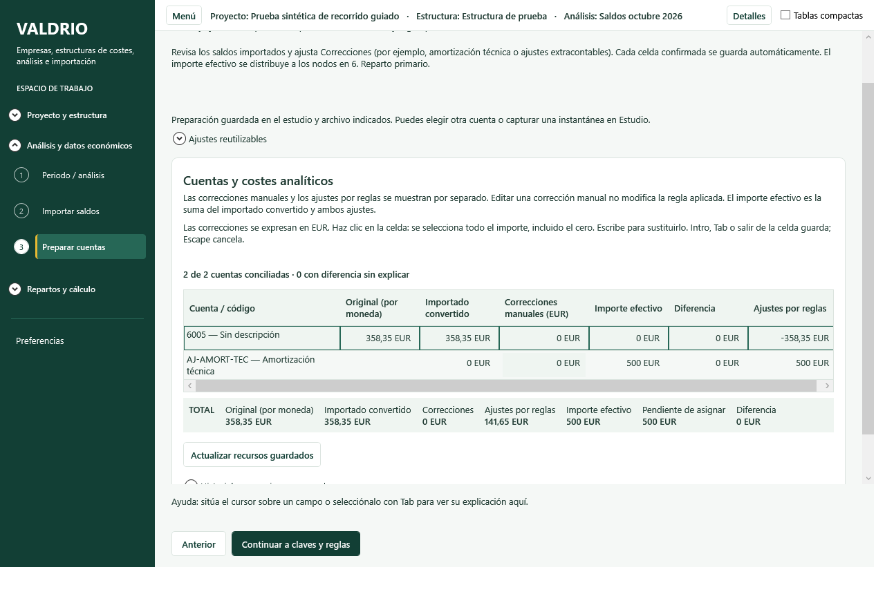
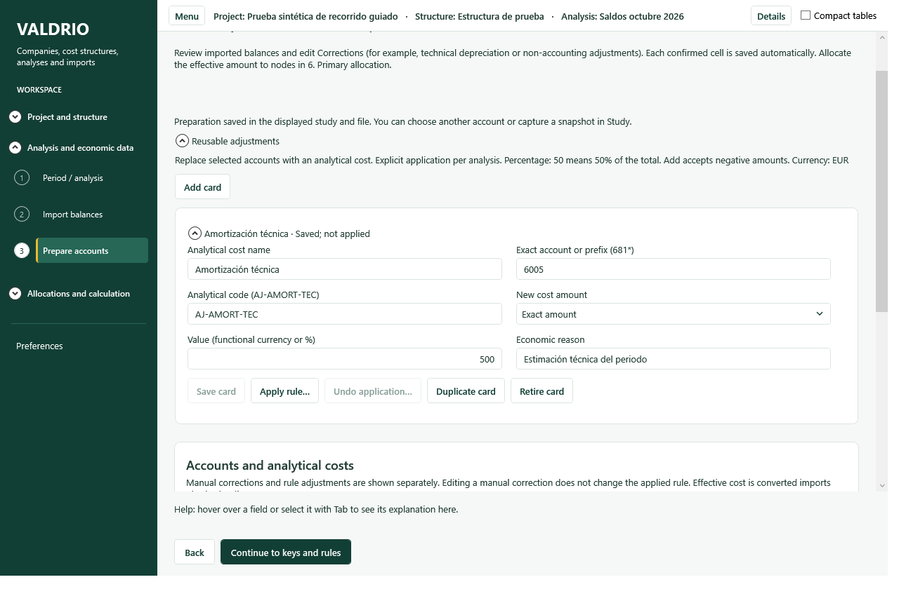

# Ajustes reutilizables — entrega candidata

Fecha: 2026-10-14. Base main@8d7ce5c4a661c9bee1e396feef1a422f72f73bfe.
Rama: `design/reusable-adjustments-20261014`. Pendiente de revisión y fusión.

## Resultado y recorrido

En **Preparar cuentas**, abrir Ajustes reutilizables, crear la ficha y guardarla. Aplicar presenta las cuentas y efectos antes de confirmar. La ficha admite cuenta exacta o prefijo, importe fijo, porcentaje o importe adicional; permite modificar, duplicar y retirar. Deshacer revierte la aplicación mientras los cálculos estén abiertos. Las fichas se comparten en el proyecto, pero cada análisis exige aplicación expresa.

Se bloquean los solapamientos entre sustituciones activas antes de aplicar y nuevamente en la transacción. Las cuentas originales se conservan y compensan; el coste analítico tiene nombre/código propios y queda pendiente de preparación. Las correcciones manuales aparecen separadas de los ajustes automáticos. No se añaden fases ni se cambian los comandos existentes de importación, preparación, reparto o cierre.

La [decisión ADR-0017](../../adr/ADR-0017-ajustes-reutilizables.md) detalla las reglas, versiones, reversión, compatibilidad y límites.

## Cobertura añadida

Nueve pruebas de integración/unidad cubren sustitución y reversión, reaplicación, solapamiento, ausencia de cuentas, revisión obsoleta, idempotencia, porcentaje/adición/saldos negativos, independencia de correcciones manuales, versiones/retirada, replay, reapertura SQLite, snapshots, disponibilidad sin autoaplicación en otro análisis, rollback transaccional, cierre/reapertura, comandos reales del ViewModel y cálculo primario antes y después de deshacer.

La comprobación WPF adicional usa controles nativos y servicios reales para guardar una ficha, abrir la previsualización, confirmar y deshacer. Se capturan la previsualización y aplicación en español y el estado revertido en inglés. La batería visual existente también se ejecuta.

## Límites y observaciones

- La aceptación visual del propietario queda pendiente. Estas comprobaciones no demuestran ausencia absoluta de regresiones ni sustituyen una prueba de usuario con datos propios.
- Los archivos históricos siguen siendo legibles; lectores antiguos pueden rechazar archivos que contienen el nuevo contrato. Usar una versión compatible con fichas.
- No se ha medido rendimiento del catálogo con miles de versiones. No se implementan programación automática, fórmulas arbitrarias ni periodificación por calendario.
- Deshacer restaura la preparación previa; se informa de que los destinos posteriores de los recursos afectados deben revisarse. Las correcciones monetarias independientes permanecen como diferencias pendientes.
- En una primera ejecución de la suite se detectó una etiqueta inglesa de historial ausente; fue corregida antes de la ejecución final. Un intento concurrente de recompilación encontró DLL bloqueada por las pruebas; se repitió secuencialmente. El primer capturador enfocaba Preferencias al buscar un botón templado; se corrigió para revelar el control real.
- No se ejecutaron workflows. GitHub Actions: **0 USD provocado por esta entrega**. Los disparadores manuales existentes no se modifican.

## Archivos de implementación

Los cambios de dominio añaden procedencia analítica opcional; Calculation valida esa procedencia; Application contiene el motor, contratos, reversión e integración con preparación/reparto; Infrastructure persiste y audita las operaciones atómicamente. Desktop añade fichas y separa columnas, conserva acciones existentes y reutiliza estilos globales. Las traducciones son ES/EN. No se modifica Reporting ni el solver matricial.

Lista de archivos de código modificados o añadidos:

- `src/Valdrio.Application/AllocationWorkspace.cs`
- `src/Valdrio.Application/PrimaryAllocation.cs`
- `src/Valdrio.Application/ResourceCorrectionCommand.cs`
- `src/Valdrio.Application/ResourceDraftEditor.cs`
- `src/Valdrio.Application/ResourceHistory.cs`
- `src/Valdrio.Application/ResourceWorkspace.cs`
- `src/Valdrio.Application/ResourceWorkspaceRules.cs`
- `src/Valdrio.Calculation/ResourcePreparationRules.cs`
- `src/Valdrio.Desktop/App.xaml.cs`
- `src/Valdrio.Desktop/ResourceEditorForm.cs`
- `src/Valdrio.Desktop/ResourceWorkspacePanel.xaml`
- `src/Valdrio.Desktop/ResourceWorkspacePanel.xaml.cs`
- `src/Valdrio.Desktop/ResourceWorkspaceViewModel.cs`
- `src/Valdrio.Domain/ResourceDraft.cs`
- `src/Valdrio.Infrastructure/CompanyFiles/SqliteCompanyFileService.Resources.cs`
- `src/Valdrio.Localization/Resources/Strings.es.resx`
- `src/Valdrio.Localization/Resources/Strings.resx`
- `src/Valdrio.Application/ReusableAdjustments.cs`
- `src/Valdrio.Desktop/MainWindow.AdjustmentSmoke.cs`
- `src/Valdrio.Desktop/ResourceWorkspaceViewModel.Rules.cs`
- `tests/Valdrio.Tests/ReusableAdjustmentTests.cs`

## Resultados finales sobre el código entregado

- Compilación Desktop Release: **0 errores, 0 advertencias** (`build.log`).
- Suite completa .NET: **664/664 superadas, 0 fallidas, 0 omitidas**, duración 4 min 9 s (`tests.log`, `test-summary.json`). Incluye las nueve pruebas nuevas.
- WPF real: proceso finalizado con código 0; **558 comprobaciones superadas en 17 registros de interacción** (`wpf-checks.json`). El total incluye 21 comprobaciones repetidas para preparar la segunda empresa de prueba y diez del nuevo recorrido de ajustes; no son 558 escenarios independientes.
- Inspección visual de las tres capturas: ficha y aviso legibles, botones de confirmación/cancelación presentes, separación entre correcciones manuales y reglas en la tabla, localización de controles en inglés. Los nombres y motivos introducidos por el usuario conservan su idioma original.
- `git diff --check`: sin errores de espacios.

Comandos locales: `dotnet build src/Valdrio.Desktop/Valdrio.Desktop.csproj -c Release --no-restore`; `dotnet test tests/Valdrio.Tests/Valdrio.Tests.csproj -c Release --no-restore`; aplicación Release con `samples/t01-smoke.valdrio-dev.json --capture-dir=artifacts/adjustments-final --methodology --adjustments`.

### Capturas de la aplicación real

## Corrección posterior: etiquetas de trazabilidad (captura del propietario)

La excepción `Missing neutral English UI resource AllocationUI.ShowSource` reveló dos claves con prefijo incorrecto: `Allocation.ShowSource` y `Allocation.BackToAmounts`. Se corrigen a `AllocationUI.*` en ambos idiomas. No cambia la lógica de cálculo.

La nueva prueba lee los bindings del XAML real de AllocationWorkspacePanel y exige que existan en todos los idiomas publicados. Antes del arreglo falla exactamente con `AllocationUI.ShowSource`; después pasan las siete pruebas de completitud/localización seleccionadas. Desktop Release compila con cero errores y cero advertencias. No se repitió la suite económica completa ni el recorrido WPF: los 664 tests y 558 comprobaciones anteriores corresponden a b70075c. Los hashes anteriores conservan esa evidencia histórica. El proceso abierto en Visual Studio debe detenerse y recompilarse para cargar los recursos nuevos.
