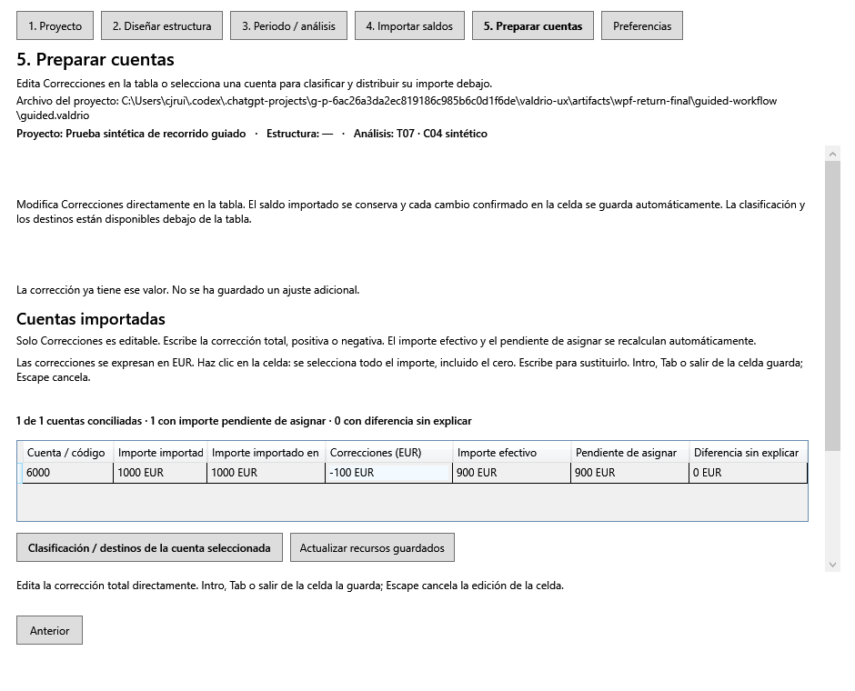
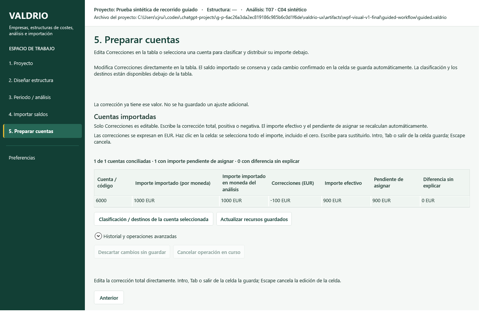
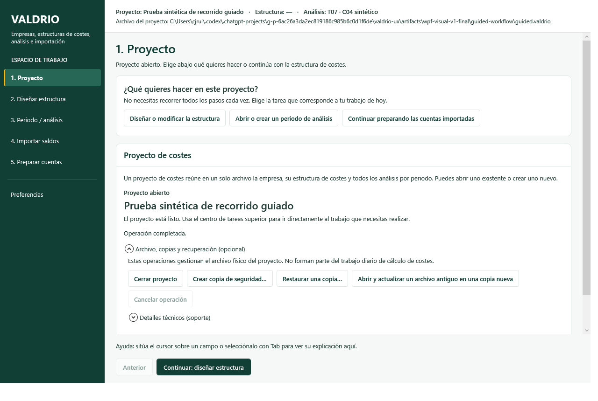

# V1 — Tema global y navegación lateral (2026-10-08)

Primera entrega de código del [plan visual](../diseno/PLAN_MIGRACION_FRONTEND.md).
La instrucción actual del propietario autoriza comenzar por el tema global y la
estructura principal sobre el desarrollo funcional más reciente. La adaptación
específica de todos los módulos (V2–V6) **no se declara terminada**.

## Base, referencia y aislamiento

- Base funcional: `5cf45b45484294129de9846ed7e7d1c8cc0a08d3`, integración de PR #27
  en `codex/local-tests-and-workspace`. La PR #27 ya está fusionada; la mención
  a su estado de borrador en el plan es el diagnóstico histórico del documento.
- Referencia normativa: `docs/diseno/` de `main`, commit
  `2a3c4b9a2c282c6e0b655e7ce31ee10f508cb637`, incluida la imagen T08 inspeccionada.
- Rama independiente: `codex/visual-standard-v1`. No se escribe en `main`, en la
  rama de PR #22 ni en el checkout de Visual Studio del propietario.
- Guía/plan/imagen se incorporan completos. AGENTS combina sus instrucciones con
  las reglas funcionales, de usabilidad y validación local ya existentes.
- La antigua rama azul `ui/desktop-visual-refresh` no se usa como referencia.

## Implementación V1

`Styles/ValdrioTheme.xaml` centraliza la paleta aprobada, tipografía, espaciados,
radios y componentes: botones, entradas, selectores, tablas, pestañas, tarjetas,
mensajes, badges, foco y navegación. Se registra desde `App.xaml`. Los estilos
locales heredan del tema; se sustituyen los colores locales, sin redistribuir los
formularios específicos de Empresa, Modelo, Estudios, Importación o Recursos.

MainWindow presenta sidebar verde, selección verde con marca amarilla, contexto
y archivo en barra blanca, cabecera del paso y área central desplazable. Conserva
los seis accesos, su habilitación, ayuda y requisitos, así como anterior/siguiente
con las mismas acciones. A ancho insuficiente hay scroll horizontal del contenido
y vertical de la navegación; el pie permanece accesible. Los textos del pie pueden
envolver sin cortar las acciones.

Se utiliza Segoe UI, fallback permitido por la guía: no hay una fuente de producto
DejaVu distribuida en el repositorio. La identidad se representa con el texto
VALDRIO existente; no se inventa un logotipo a partir de la miniatura T08. Para
texto pequeño se usa `Text.Primary` en lugar del token secundario de bajo contraste.
Los tokens de marca aprobados permanecen intactos.

## Preservación y matriz funcional

Comparación XML contra la base: **215 controles con nombre, 880 expresiones Binding
y 26 conexiones de eventos conservados**, sin pérdidas. Incluye comandos y
visibilidades enlazados. El inventario y los resultados están en
[validation.json](visual-v1/validation.json).

| Vista | Controles | Bindings | Eventos | Validación real conservada |
|---|---:|---:|---:|---|
| Principal | 38 | 108 | 13 | Seis destinos, requisitos, retroceso, avance, ayuda, preferencias |
| Empresa | 17 | 63 | 0 | Crear/abrir/cerrar, unidades, backup/restauración/upgrade |
| Modelo | 42 | 149 | 1 | Centros, nodos, unidades, guardar/publicar/clonar y árbol |
| Estudios | 20 | 76 | 2 | Periodo, guardar/reabrir, modelos, snapshots y recuperación |
| Importación | 51 | 255 | 5 | Cinco pasos, formatos, exclusión, Debe/Haber, FX, confirmación |
| Recursos | 47 | 229 | 5 | Corrección inline, delta, Escape, destinos, persistencia y reapertura |

No hay cambios en Domain, Application, Calculation, Infrastructure ni en el corpus
canónico de `specification/`. No se modifica la lógica económica, la persistencia,
los permisos ni la interpretación de importes. El único cambio de presentación
en Guidance añade la etiqueta localizada del grupo de navegación.

La comprobación de solapamientos se adapta al nuevo contenedor central: incluye
todos los hijos visibles, también la cabecera, y excluye los rectángulos conservados
por WPF de vistas colapsadas. No se eliminan comprobaciones funcionales.

## Validación local

- `dotnet build Valdrio.slnx -c Release --no-restore`: 0 errores, 0 advertencias.
- `dotnet test tests/Valdrio.Tests/Valdrio.Tests.csproj -c Release --no-build`:
  **534/534**, sin fallos ni omisiones. Recibo: `artifacts/tests/visual-v1.trx`.
- Aplicación WPF real con `--capture-dir` y preferencias aisladas:
  **419 comprobaciones** correctas, proceso terminado con código 0.
  Recibos y capturas: `artifacts/wpf-visual-v1-final/`.
- 53 comprobaciones nuevas de shell: invocación de los seis handlers ES/EN,
  selección, foco, pie y espacio de trabajo; ventana 760×620; pseudo-RTL y
  composición ampliada al 125/150/200 % mediante LayoutTransform WPF.
- DPI del monitor de prueba: 96. **No se ha probado el traslado entre monitores
  con DPI distintos**; la ampliación de layout no se presenta como esa prueba.
- Comparadas capturas nativas con la referencia: shell, formularios, tabla de
  recursos, ventana estrecha, escala 200 % y pseudo-RTL. Se mantienen pendientes
  las revisiones visuales detalladas de cada panel en V2–V6.
- GitHub Actions: **ninguna ejecución**. Configuración efectiva de la rama y base
  revisada antes de publicación: `workflow_dispatch` exclusivamente.

## Capturas reales

Antes, base funcional validada (T07, datos sintéticos):

Después, mismo punto del recorrido nativo de T07:

Ventana principal y contexto del proyecto con el nuevo shell:

## Continuación del plan

La base técnica V1 está aplicada y validada localmente. V2 adapta la composición
de Empresa y Modelo; V3 Estudios; V4 el asistente de importación; V5 Recursos;
V6 cierra diálogos/estados/accesibilidad y la revisión integral. Permanecen en
esas fases la jerarquía particular de acciones, alineación de todas las cantidades,
layout maestro/detalle y revisión de controles nativos auxiliares. Los diálogos
del sistema operativo conservan su comportamiento nativo. No se implementa T08
ni se añaden usuarios, KPIs, botones o pantallas ficticios para imitar la imagen.
