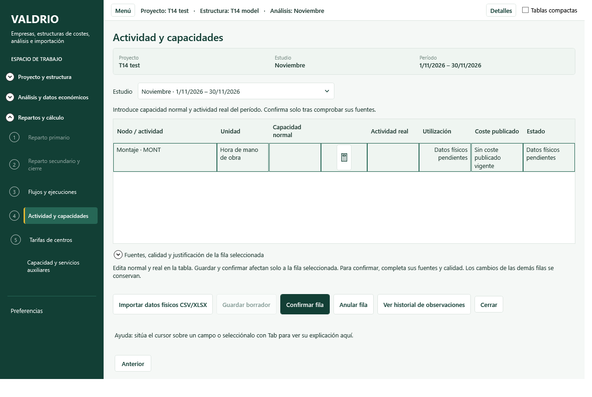
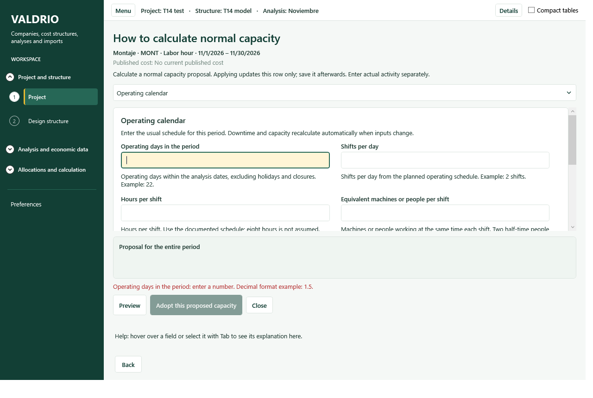
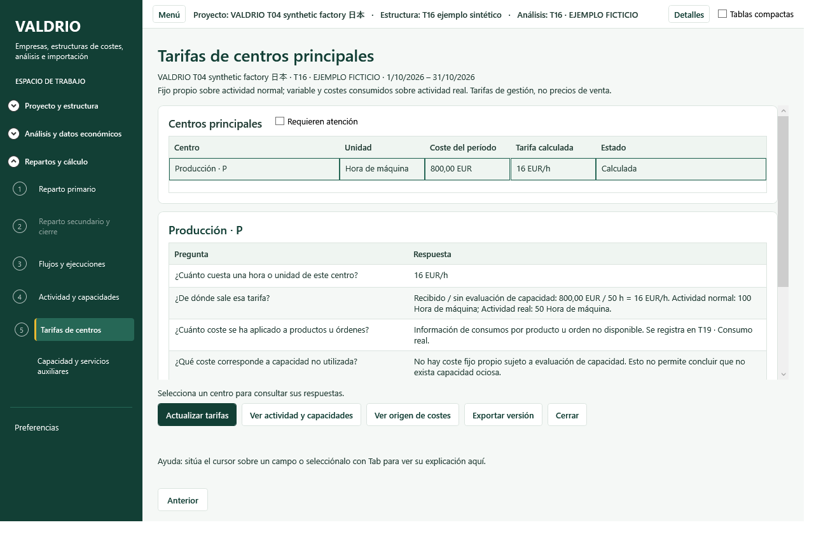
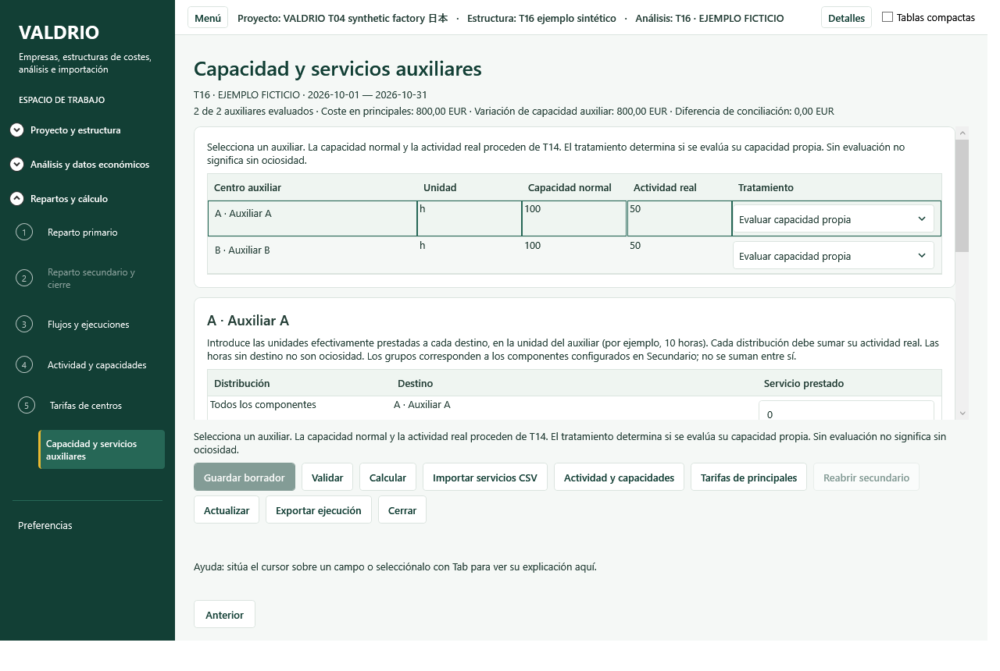
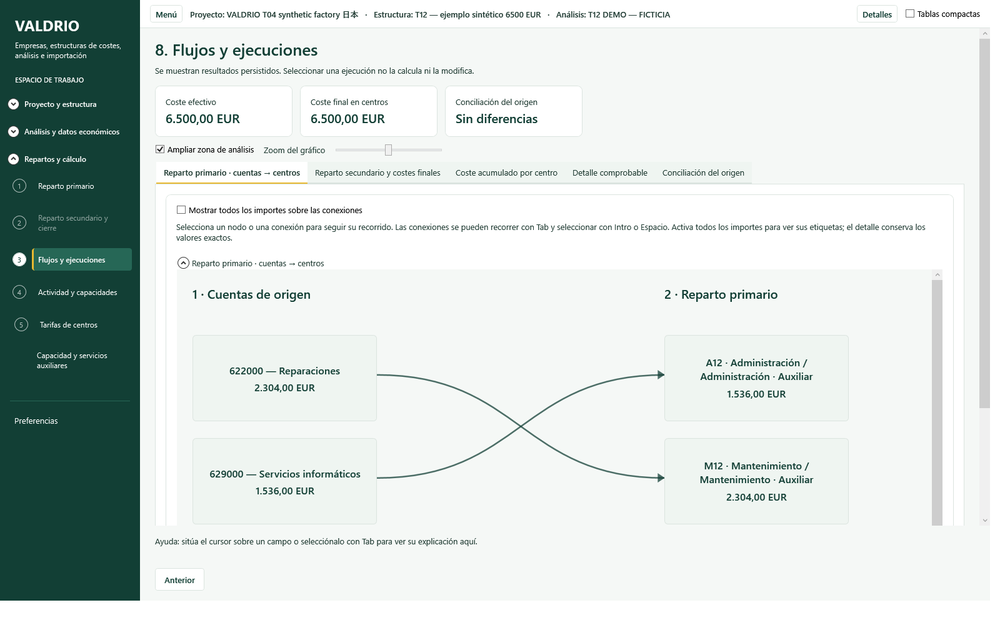

# Auditoría de rendimiento e integración — 20 de octubre de 2026

## Estado y alcance comprobado

Base: `main` de GitHub, SHA `246284c9ecd69fe66edc200d152f7776bc6de3b1`,
contrastado con `git ls-remote`. Rama local:
`fix/integrated-workspace-performance-20261020`.

Se han corregido lecturas redundantes de T14 y la apertura modal de las
pantallas de trabajo. Se conservan los motores económicos y el formato
`.valdrio`. La entrega **no certifica todavía todos los criterios de la
auditoría integral**: la demora reportada de 30–40 s no se reproduce con
el proyecto sintético disponible y falta la aceptación interactiva de todos
los avisos de descarte. No equiparar los resultados de un ejemplo pequeño
con los de un proyecto real de gran volumen.

No se han ejecutado workflows, enviado cambios a GitHub ni modificado
facturación. Gasto provocado en GitHub Actions: **0 USD**.
Los archivos sincronizados de `sources/` permanecen sin cambios.

## Diagnóstico técnico y correcciones

### T14: apertura y edición de la calculadora

Ruta original:

1. `PhysicalActivityWindow.AssistNormal` confirma la edición de la tabla,
   selecciona el registro del botón y construye el asistente.
2. `PhysicalCapacityAssistantEditor` consulta `CalendarSupported` al
   inicializar, restaurar la fórmula y previsualizarla.
3. `CalendarSupported` accedía a `PhysicalActivityEditor.Structure`.
   Su getter llamaba cada vez a `models.ReadModels()`.
4. Las lecturas de los servicios SQLite pasan por la validación del archivo.
   `SqliteCompanyFileService.Validate` comprueba esquema, integridad,
   auditoría, modelos, importaciones, recursos, repartos, ejecuciones y
   observaciones físicas. No es una consulta trivial de una propiedad.
5. Además, el constructor leía referencias históricas de toda la empresa,
   aunque el usuario estuviera usando calendario o capacidad declarada.
6. `ShowDialog` mostraba finalmente una ventana independiente.

La medición distingue lectura de estructura, histórico, constructor y
presentación hasta `DispatcherPriority.ApplicationIdle`. Los resultados
del ejemplo confirman coste de E/S redundante; **no demuestran que esa
fuera la única causa de los 30–40 s reportados**.

Solución:

- `Structure` conserva la estructura publicada que `Reload` ya necesitó
  para construir las filas. La estructura publicada es inmutable.
  Se sustituye en cada recarga y se restaura si falla el cambio de estudio.
- Calendario y capacidad declarada no leen persistencia al abrir ni al
  teclear. El histórico se obtiene al seleccionar ese método.
- `ReadReferences` recupera el estudio una vez, fuera del filtro de
  resultados; conserva las reglas de versión, confirmación y período.
- Cada asistente captura su propia fila y sus propios campos de propuesta.
  La capacidad declarada abre directamente ese método.
- El botón es un icono vectorial de 32 px con tooltip, nombre accesible,
  tabulación y estado de permisos.
- Adoptar modifica la fila, como antes; guardar/confirmar sigue siendo una
  acción explícita posterior. Cerrar sin adoptar no modifica la fila.
- No se ha eliminado ninguna validación de integridad al abrir, consultar
  los servicios de persistencia o guardar.

Prueba de regresión nueva:
`T14_CalendarOpeningAndTypingDoNotReadPersistenceAndKeepZeroDistinctFromEmpty`.
Después de cargar el editor cierra la sesión de persistencia y verifica que
abrir/editar la propuesta sigue funcionando, que cero no se convierte en vacío,
que no se modifica la fila al escribir y que una nueva instancia no hereda
entradas temporales.

### Origen de las ventanas independientes

| Pantalla | Causa técnica | Cambio responsable identificado | Corrección |
|---|---|---|---|
| Actividad y capacidades | `Window` y `ShowDialog` desde menú y estudio | `10bde65`, 15/10, incorporación T14.2; posteriores cambios mantuvieron el patrón | Contenido integrado en el shell |
| Tarifas de centros | `PrincipalRatesWindow` y apertura modal, incluida entrada desde auxiliares | `e07055e`, 18/10, incorporación T15 | Contenido integrado; retorno y consulta de costes conservados |
| Capacidad y servicios auxiliares | `AuxiliaryCapacityWindow` modal, con otras ventanas anidadas | `aef3819`, 18/10, incorporación T16 | Contenido integrado; navegación interna y recarga tras operaciones |

En el historial disponible estas clases nacieron como ventanas; no se ha
encontrado una versión integrada previa de esas mismas pantallas. El código
demuestra la decisión de implementación, pero no documenta una aprobación
de UX ni permite atribuir la intención personal de quien la introdujo.

Otros formularios afectados: calculadora, importación física, mapeo de
importación contable y reutilización de reglas. Sus entradas de producción
también pasan al contenedor integrado.

### Contenedor de trabajo

`MainWindow.IntegratedWorkspace.cs` mantiene una pila de superficies dentro
de `WorkspaceContent`; el menú y la cabecera permanecen accesibles. Volver
restaura la instancia anterior. Cambiar de módulo o proyecto comprueba los
cambios pendientes antes de liberar las superficies. Cerrar una superficie
retira su registro de WPF; Escape se dirige a la página, no a la ventana
principal. Los botones globales de otro módulo se ocultan durante la edición
contextual.

`IntegratedWorkspaceWindow` es un adaptador de los XAML existentes. Desacopla
su contenido antes de presentarlo en el shell, conserva recursos, nombres,
eventos y lógica, y no llama a `Show` ni a `ShowDialog` en producción.
Las clases aún derivan de `Window` para conservar los arneses visuales
aislados existentes: **no se afirma haber completado una migración estructural
de todas ellas a `UserControl`**. La prueba integrada comprueba que no se crea
un identificador de ventana nativa y que solo queda la ventana principal
después de las aperturas/cierres.

Los diálogos de confirmación y los selectores de archivo del sistema
permanecen. Las aperturas `Show` de los archivos `*Smoke.cs` son arneses
de prueba, no entradas de navegación del producto.

## Visualización y usabilidad

- Gráficos primario/secundario, saldos, detalle y conciliación se consultan
  en pestañas, sin apilar todas las tablas antes de los gráficos.
- Zoom de 50 % a 200 %, desplazamiento en el área gráfica y modo ampliado
  dentro de la ventana principal. Se mantienen visibles los totales.
- Se conservan selección de nodos/conexiones, trazabilidad, etiquetas
  opcionales, selección por teclado y detalle con importes exactos.
- Se mantiene el grafo dirigido existente: conserva transferencias internas
  y recíprocas. No se ha sustituido por un Sankey acíclico que ocultaría ciclos.
- El historial de ejecuciones conserva su selector, estado, errores y acciones,
  separado de las pestañas de análisis económico. Se muestra el tiempo
  transcurrido persistido si existe fecha de finalización; no se inventan
  duraciones por fase ni se presenta ese intervalo como tiempo de CPU.
- Se preservan los recursos ES/EN y los tokens del sistema visual V1.

La navegación existente muestra tres fases implementadas. No se añaden
pantallas ficticias para completar las seis fases previstas; producción,
decisiones e informes requieren funcionalidades que esta intervención no
implementa. Tampoco se presenta la barra de procesamiento como porcentaje
de avance del análisis económico.

## Método de medición y reproducibilidad

Los datos crudos y la tabla calculada están en `antes.json`, `despues.json`
y `comparativa.json`. [Tabla legible con primera apertura y sucesivas](RENDIMIENTO.md).
La apertura total medida pasa de **259,52 a 105,35 ms de mediana** y de
**307,99 a 134,99 ms de P95** en ese ejemplo; reducción de mediana: **59,4 %**.
Mediana: promedio de los dos centrales para N par.
P95: rango más próximo, `ceil(0.95 × N)`. Se conserva la primera apertura y
se separan las 19 siguientes. El total de apertura es la suma de construcción
y renderizado **por iteración**, no la suma de percentiles.

Condiciones: Windows local, .NET SDK 10.0.401, compilación Debug, mismo equipo,
20 aperturas, proyecto sintético T14. Las copias antes/después conservan SHA256:
`A45A39592D07284C464C042AD17E3EDE54A866F3DA1D4AFDCB6904CF224DB108`.
El proyecto tiene una fila de actividad en el análisis utilizado.

La primera apertura es la primera instancia de calculadora después de cargar
el proyecto y ejecutar las sondas de lectura; **no equivale a un arranque con
caché de disco fría**. Las mediciones posteriores a la corrección muestran el
contenido integrado; las anteriores muestran la ventana original. Las
capturas se realizan fuera del intervalo medido.

Ejecutar sobre una copia desechable:

```powershell
dotnet build src/Valdrio.Desktop --no-restore -m:1
& ./src/Valdrio.Desktop/bin/Debug/net10.0-windows/Valdrio.Desktop.exe `
  --performance-checks-only --capture-dir=artifacts/medicion `
  --preferences-path=artifacts/medicion-preferencias.json copia.valdrio
```

`MainWindow.PerformanceChecks.cs` registra también lecturas independientes;
esas sondas deliberadas no forman parte del tiempo de apertura. La
comparación no mide clic físico→primer feedback ni latencia de red.
Solo hay una muestra de apertura de proyecto/estudio en cada ejecución:
no se atribuye una mediana o P95 poblacional a esa operación.

Para generar datos de repartos vigentes, se usaron las pruebas existentes
`T12_6500FlowsPersistAndHistoricalReadDoesNotRecalculate` y
`T16_C20_PersistsTransmitsOnceAndRestoresHistoricalRates`, con sus variables
`VALDRIO_T12_DEMO` y `VALDRIO_T16_DEMO` apuntando a copias en `artifacts`.

## Validación y límites

- Compilación local sin errores.
- Suite completa: 736 pruebas superadas, sin omitidas, 5 min 22 s.
  El archivo `validacion-final.json` precisa las comprobaciones posteriores
  a los últimos ajustes de presentación.
- Inventario de ocho vistas: ningún control con nombre ni comando original
  eliminado. Consultar `inventario-controles.json`. Esta comprobación estática
  no sustituye una aceptación interactiva completa.
- Prueba WPF del flujo de costes: conciliación de 6.500 EUR, transferencias
  recíprocas, selección, consulta histórica sin recálculo, ES/EN, ventana
  estrecha y escalas 125/150/200 %. `graficos-checks.json` conserva las
  aserciones realizadas.
- Calculadora y T14/T15/T16: renderizado integrado, sin identificadores de
  ventana nativa, identidad de la fila comprobada y liberación de la pila.
- 22 comprobaciones del menú real: entrada mediante AutomationPeer/teclado,
  proyecto sin análisis, edición pendiente conservada al cancelar, descarte
  explícito, retorno con «Anterior», contexto y revisión sin cambios, ES/EN.
  El arnés se actualizó para esperar una página integrada en lugar del bucle
  modal antiguo. Véase `menu-checks.json`.
- En el ejemplo T16 se pulsaron los iconos de dos filas distintas manteniendo
  otra fila seleccionada: cada formulario mostró exclusivamente los datos de
  la fila pulsada, en ambos idiomas.
- Las pruebas existentes cubren cálculo, versiones, publicación,
  cierre/reapertura y persistencia. No se han modificado algoritmos de costes.
- El primer intento de la suite en el aislamiento no conectó con `testhost`;
  se repitió localmente con el permiso de ejecución correspondiente.
- El primer ejemplo de gráficos tenía una ejecución desactualizada y falló
  la precondición `current revision`. Se generó un ejemplo nuevo con el
  servicio real, sin debilitar la aserción.
- El primer recorrido del archivo T16 eligió el análisis inicial de la
  fixture, no el análisis `T16`. Su configuración auxiliar no estaba guardada
  y el aviso de descarte bloqueó el cierre automatizado. Se cerró únicamente
  ese proceso sintético y se corrigió la selección del análisis en el arnés;
  no se desactivó la guarda de producción ni se guardaron datos para evitarla.
- Falta ensayar con interacción humana todos los caminos «guardar /
  descartar / permanecer», permisos y resolución/DPI de cada formulario
  integrado. No se certifica ausencia universal de fugas solo por comprobar
  el número de ventanas tras varias aperturas.

## Evidencia visual

La [referencia anterior de la calculadora](calculadora-referencia-anterior.png)
procede de la aceptación previa del 18/10; no es una captura nueva de la misma
sesión de medición. Las siguientes imágenes corresponden al código modificado:











## Pendientes priorizados

| Prioridad | Incidencia / impacto | Evidencia y causa | Acción siguiente | Esfuerzo orientativo / riesgo |
|---|---|---|---|---|
| P0 | Demora reportada de 30–40 s | No reproducida; referencia recibida: `main`, sin archivo/registro concreto | Repetir perfil con el proyecto afectado, registro, volumen y condiciones; contrastar P95 inicial/sucesivo | 0,5–2 días una vez disponible / medio |
| P1 | Validación global repetida en servicios | `Validate` recorre el archivo desde múltiples lecturas; impacto depende de volumen | Medir con proyectos grandes y diseñar sesiones/snapshots sin debilitar detección de corrupción ni concurrencia | 2–5 días / alto |
| P1 | Histórico T14 grande | Carga diferida, pero la selección del método histórico sigue siendo síncrona | Perfil por volumen; carga cancelable y consulta acotada por pool si procede | 1–2 días / medio |
| P1 | Aceptación de descarte y permisos | Guardas conservadas/ampliadas; no todos los diálogos se han recorrido interactivamente | Matriz completa de guardar, cancelar, cerrar, cambiar proyecto y cambiar período | 1–2 días / medio |
| P1 | Comparativa global pendiente | No hay series antes/después para importación, apertura de proyectos grandes y todos los gráficos | Corpus representativo, medidas de carga inicial/sucesiva y presupuestos por operación | 2–4 días / medio |
| P2 | Adaptador de vistas todavía deriva de Window | Solución de presentación sin duplicar XAML ni lógica; producción sin ventanas nativas | Migrar gradualmente a UserControl y actualizar arneses, conservando evidencia | 1–3 días / medio |
| P2 | Redibujado completo de grafos | `CostFlowPanel.Draw` reconstruye ambas escenas al cambiar selección/tamaño | Perfil de grafos densos; actualización incremental o agrupación de invalidaciones | 1–3 días / medio |
| P2 | Fases de ejecución sin tiempos individuales | Solo se persisten tiempos globales y resultados de la ejecución | Definir telemetría por fase si se necesita; no inventar estados ni duraciones | 1–2 días / medio |
| P2 | Reglas reutilizables de ajustes e idempotencia | Fuera de las correcciones de presentación; hay desarrollo previo en otra rama | Revisar diseño existente y pruebas de repetición sin sobrescribir trabajo paralelo | Por estimar / alto |
| P2 | Consulta histórica a escala | Pruebas existentes de inmutabilidad pasan; falta corpus grande | Medir acceso y trazabilidad sin recalcular cierres | 1–3 días / medio |
| P3 | Acabado en todas las resoluciones y densidades | Capturas focalizadas, no auditoría exhaustiva de todas las pantallas | Revisión de textos largos, contraste y disposición en corpus completo | 1–3 días / bajo |

Las estimaciones son de trabajo técnico, no compromisos de plazo.
