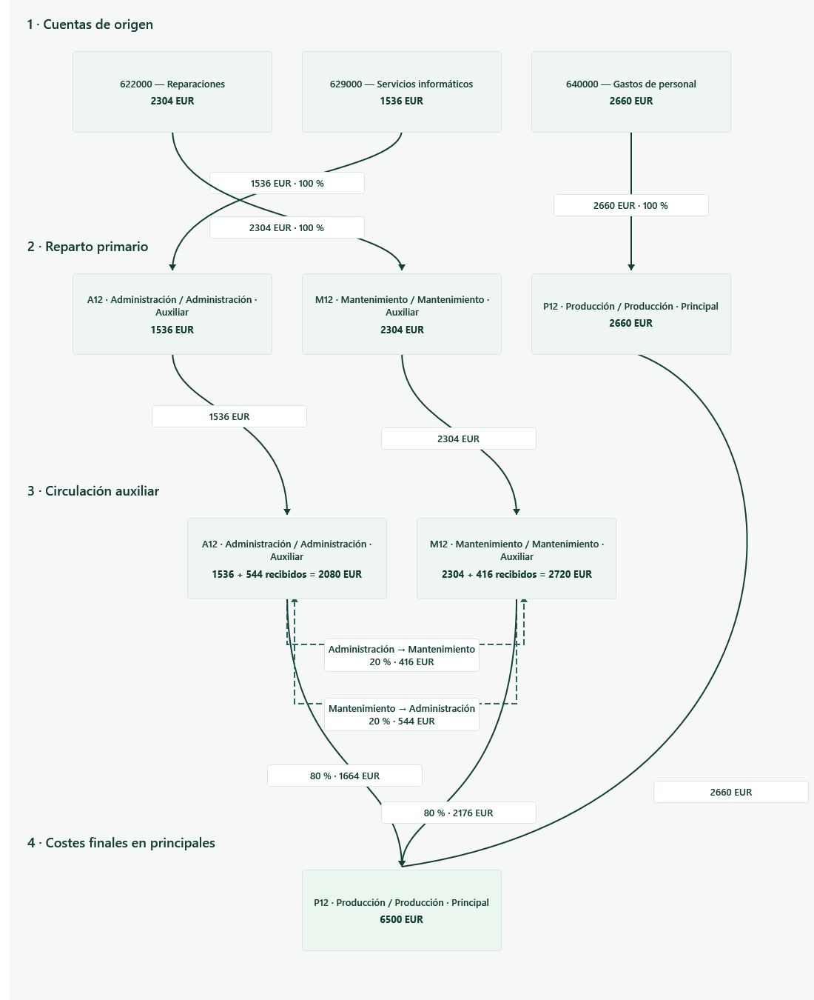

# T12 — evidencia local, 2026-10-11

Base: `main@e888693`. Desarrollo: `feature/t12-cost-flow-history`.
Windows local, SDK .NET 10.0.401, Release. No GitHub Actions ni cambios de facturación.

## Revisión previa y alcance

Se revisaron el repositorio y AGENTS.md, guía visual aprobada, USABILIDAD,
fichas T09–T12 (incluidas las normativas v0.4), contratos de snapshots,
primary/secondary publications y reglas de precisión/localización.
La integración anterior T11 quedó en main después de 627/627 pruebas:
[registro](../t11-main-20261011/README.md).

T12 reutiliza T09–T11. El código de cálculo no se llama al seleccionar una
entrada del historial. La lectura de runs tiene un camino de persistencia propio,
sin replay de AllocationWorkspace. La apertura general del archivo conserva
la comprobación histórica previa de cierres T11.

## Comandos reproducibles

```powershell
dotnet build Valdrio.slnx -c Release --no-restore -m:1 -nr:false -p:UseSharedCompilation=false
dotnet test tests/Valdrio.Tests/Valdrio.Tests.csproj -c Release --no-build --no-restore --filter "Name~M01_UpgradeGenuine|Name~S01_ExistingUpgrade|Name~T12_" --logger "console;verbosity=normal"
dotnet test tests/Valdrio.Tests/Valdrio.Tests.csproj -c Release --no-build --no-restore --blame-hang-timeout 90s --blame-hang-dump-type none --logger "console;verbosity=normal" --logger "trx;LogFileName=t12-verified.trx" --results-directory artifacts/t12-verified
```

Build: **0 errores, 0 advertencias**, 19,16 s (`build.log`).
Focalizadas: **9/9**, 22,8947 s (`targeted-tests.log`).
Batería completa: **634/634**, 3,4737 minutos (`full-tests.log`).

La suite incluye conservación del ejemplo, reapertura idéntica, revisión cambiada
entre preparación y publicación, circuito sin salida sin hechos finales inventados,
cancelación, rollback tras primera escritura y antes de commit, inmutabilidad,
y comparación de importes/hashes en es-ES/en-US/tr-TR.

## Iteraciones y defectos encontrados

- El intento con `VALDRIO.sln` falló MSB1009: la solución real es `Valdrio.slnx`.
  El build paralelo sin opciones devolvió fallo sin diagnóstico; el comando
  serial reproducible anterior compila correctamente.
- Primera batería: 631/634. El límite de ocho upgrades rechazaba archivos que
  pasaban de formato 1 a 10. Se corrigió a SchemaVersion - 1.
- Segunda: 632/634. Dos pruebas todavía esperaban ocho eventos de migración:
  deben existir nueve (formatos 1 → 10).
- Tercera: 633/634. La revisión máxima de esos nueve eventos debe ser ocho,
  porque empieza en cero. Se corrigió esa comprobación adicional.
- No se cambiaron importes esperados ni contratos económicos para hacer pasar
  las pruebas. Se conservan logs de esas iteraciones junto al resultado final.
- WPF: se detectó visualmente el solapamiento de una etiqueta de reciprocidad;
  se separaron los carriles de rótulos terminales. Se añadió barra horizontal
  superior para la ventana estrecha y protección de cierre durante cálculo.

## Comprobación WPF real

Sobre una **copia desechable** del fixture:

```powershell
$smokeProcess = Start-Process -FilePath 'src/Valdrio.Desktop/bin/Release/net10.0-windows/Valdrio.Desktop.exe' -ArgumentList @('<copia-del-fixture.valdrio>', '--cost-flow-only', '--capture-dir=<directorio-absoluto>') -WindowStyle Hidden -PassThru
$smokeProcess.WaitForExit()
$smokeProcess.ExitCode
```

Salida **0**, **28/28** comprobaciones (`checks.json`): cuatro etapas, cuatro
transferencias, reciprocidad, final 6500, revisión actual, cálculo/publicación
mediante comando de la pantalla, selección de ejecución anterior idéntica,
consulta inmutable, selección de origen/flecha, tablas en ventana de 960 px y
foco de teclado. Todo en español e inglés. Capturas también en 1600 px.
Se inspeccionaron las capturas y se corrigió el solapamiento señalado.
Esto no acredita todas las combinaciones posibles de grafos grandes ni una
sesión manual completa de accesibilidad con lector de pantalla.



## Fixture de aceptación

Generado exclusivamente por `T12Fixture` en `T12RunTests.cs`, a través de los
servicios reales de modelo, importación, recursos, claves, cálculo y persistencia.
Para regenerarlo en un destino **nuevo**:

```powershell
$env:VALDRIO_T12_DEMO = '<ruta-absoluta-nueva.valdrio>'
dotnet test tests/Valdrio.Tests/Valdrio.Tests.csproj -c Release --no-build --no-restore --filter 'Name~T12_6500FlowsPersistAndHistoricalReadDoesNotRecalculate'
Remove-Item Env:VALDRIO_T12_DEMO
```

Entregado en `Downloads/VALDRIO_T12_Demo_6500.valdrio`. SHA-256 en `fixture.json`.
Abrirlo con la compilación T12, seleccionar estudio **T12 DEMO — FICTICIA** y
paso **8. Flujos y ejecuciones**. Tiene una ejecución completada; no necesita
importar ni calcular para visualizarla. Es formato 10 y no se abre con un binario
antiguo que solo conozca formato 9.

| Concepto | EUR |
|---|---:|
| Origen | 6500 |
| Mantenimiento → Producción (80 %) | 2176 |
| Mantenimiento → Administración (20 %) | 544 |
| Administración → Producción (80 %) | 1664 |
| Administración → Mantenimiento (20 %) | 416 |
| Final Producción | 6500 |
| Diferencia | 0 |

Los 960 EUR internos no se suman al total final. Las flechas muestran movimientos
brutos, los costes finales muestran importes publicados con ajustes PDEC-1/T11.

## Continuidad explícita

[ADR-0015](../../adr/ADR-0015-ejecuciones-y-flujos-persistidos.md) documenta el
CurrentRunId derivado, snapshots históricos, y la falta de un ledger por cuenta
para cada salto interno: se presentan grupos brutos y contribuciones finales por
recurso, sin fingir esa desagregación. T12 no modifica las propuestas A05/PNUM-1
ni convierte cierres T11 antiguos en ejecuciones. La aceptación del propietario
y la fusión de esta rama T12 están pendientes.
