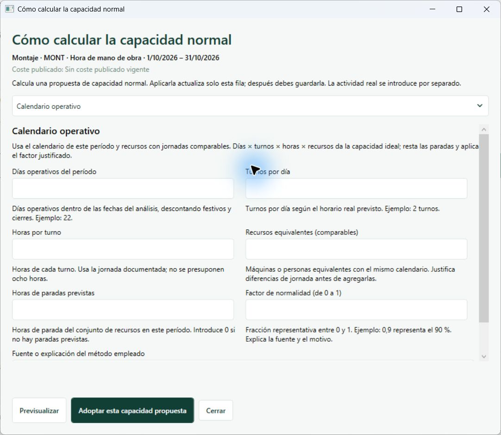
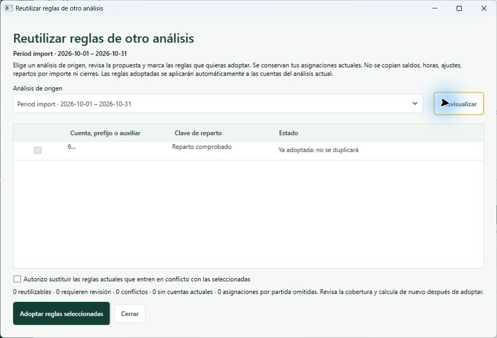

# T14: correcciones, interfaz Windows y reutilización de reglas

Fecha: 15/10/2026. Base funcional: PR #55, `85ef4cfd311fa8d2e709f9f79192f41429aaeedd`. Rama de revisión: `fix/t14-local-validation-20261015`. Se integra también el corte documental `main@4aa747c`, conservando su contenido histórico. El propietario autoriza expresamente la fusión después de finalizar las comprobaciones.

## Fuentes contrastadas

- Código real de la rama T14, `AGENTS.md`, ficha T14 y directrices de capacidad asistida, integración, usabilidad y sistema visual V1.
- Especificación PDF v0.4 adjunta, prompt maestro y `VALDRIO_Paquete_Desarrollo_v0_4.zip`: T14, CM08 y referencias C15/C16/C18/C19/C31. Los archivos sincronizados y los contratos canónicos permanecen intactos.
- Rama indicada por el propietario, localizada como `docs/realidad-aplicacion-20261015`: inventario funcional, plan de verificación y **PEND-RP-01**. El nombre literal «Revisión y pendientes del informe.txt» no aparece en esa rama; se utiliza la especificación RP-01 documentada allí, sin atribuirle contenido no encontrado.
- Reglas extracontables: ADR-0017 y evidencia de ajustes reutilizables. Su aplicación continúa siendo expresa por análisis; la reutilización de repartos no traslada aplicaciones ni importes de ajustes.

## Errores corregidos

1. La compilación WPF fallaba por referencias de entrada/salida sin importar su espacio de nombres.
2. El validador del historial de migraciones no reconocía correctamente la transición SQLite 10 → 11; una actualización legítima quedaba marcada como archivo inválido.
3. La confirmación de una fila incompleta devolvía antes un error de evidencia. Ahora identifica primero las cantidades que faltan.
4. La anulación reemplazaba el motivo de excepcionalidad original. Se conserva y se registra aparte el motivo de corrección/anulación.
5. Importar usaba la última versión en el momento de aplicar, aunque el usuario hubiera revisado otra. Se compara con la versión de la previsualización y se rechazan cambios concurrentes. Una fila anulada no resucita cantidades antiguas durante una importación parcial.
6. Los números nativos de XLSX se interpretan con su formato invariante; el texto respeta el perfil regional. Se rechazan booleanos, errores y fórmulas sin caché utilizable; una fecha vacía genera diagnóstico. No se confunde `1.5` con `15` en entrada textual española.
7. El calendario rechaza días superiores al período y jornadas superiores a 24 horas. El método requiere una unidad horaria compatible. El histórico conserva motivos de exclusión y exige duración comparable al destino. Una declaración no hereda la justificación de un cálculo anterior.
8. Guardar una fila conserva los cambios pendientes de otras filas. El estado muestra «Cambios sin guardar», el porcentaje se actualiza al editar y deshacer la edición restaura el estado guardado.

## Interfaz y preservación de funciones

Inventario conservado: contexto proyecto/estudio/período, selector con protección de cambios, normal/real, utilización y coste de solo lectura, fuentes/calidad, capacidades avanzadas, motivos, calculadora con tres métodos, importación, borrador, confirmación, anulación, historial y cierre. Los estudios cerrados siguen siendo de solo lectura.

La tabla ocupa más altura; las fuentes quedan en un desplegable accesible. La calculadora está en cada fila y actúa sobre esa fila. Sus ayudas explican entradas y unidades; la propuesta no se guarda automáticamente. Se eliminan códigos internos T12/T14 de los textos habituales, se ajustan textos largos, se alinean cantidades y se usa foco amarillo mediante los recursos del tema. Se conserva verde profundo, superficies claras, contraste y acciones principales existentes.

Se revisaron ventanas WPF reales con servicios SQLite y datos sintéticos, en español e inglés: apertura del análisis, tabla, calculadora, rechazo de 32 días en octubre, cancelación sin alterar 700/610, estado guardado y acceso al primario. La revisión detectó truncamiento de coste y botones de adopción activos sin selección; ambos se corrigieron. Las capturas incluidas muestran el recorrido durante la revisión, antes de esos últimos retoques de presentación/estado, no una certificación de todas las resoluciones.




## PEND-RP-01 implementada

Desde **Reparto primario → Reutilizar reglas de otro análisis**, seleccionar origen, previsualizar, elegir reglas compatibles y adoptar. La previsualización distingue compatibles, ya presentes, conflictos, sin cuentas actuales, claves inválidas, modelos diferentes, drivers mensuales y grupos específicos. Las cuentas exactas llevan descripción disponible; los prefijos conservan identidad textual.

Decisiones técnicas de esta entrega:

- Adopción después de importar, desde Primario. No se añade una puerta ni un cierre de Recursos. Se comprobó la apertura de Primario con partes pendientes; Secundario sigue requiriendo el cierre primario.
- Misma empresa y estructura efectiva idéntica. Un modelo diferente queda como referencia que exige revisar/publicar claves compatibles; no se inventa un mapeo.
- Se reutilizan versiones publicadas porcentuales/equitativas y reglas exactas/prefijos; las reglas secundarias del grupo general se adoptan antes del cierre primario. Las claves por mediciones y grupos vinculados a partidas requieren revisión en el período actual.
- No se copian importes, saldos, aplicaciones extracontables, horas, `PartId`, asignaciones absolutas, cierres ni ejecuciones. Se preservan asignaciones y descripciones propias del destino.
- No se reemplaza un conflicto sin elección expresa. La operación guarda origen, revisión, huella y selección en el recibo/auditoría existente, dentro de una sola transacción. Se revalida origen/destino; repetir no duplica reglas y repetir una solicitud es idempotente.
- La resolución de cuentas utiliza el motor existente: manual, exacta, prefijo más largo y prioridad. No se modifica el solver ni se añaden porcentajes por defecto. La reversión metodológica utiliza la edición/eliminación de reglas del destino y su historial; no borra recibos.

## Pruebas locales y aceptación

SDK .NET 10.0.401, Windows. Ningún workflow, runner alojado ni cambio de facturación.

| Verificación | Resultado |
|---|---|
| Compilación de `Valdrio.slnx`, Release | Sin errores ni advertencias |
| Regresión completa tras correcciones de motor/persistencia | 714/714, 6 min 14 s |
| Pruebas adicionales y ajustes posteriores | Ver `validation.json` y `focused-final.trx` local |
| Referencias racionales v0.4 | 39/39; no sustituyen pruebas C#/WPF |
| Claves de mensajes de producción | 543 encontradas, completas ES/EN |
| Integración documental de main | Sin cambios de código respecto al estado probado |

Los casos específicos comprueban migración/reapertura, versiones físicas, ceros/ausentes/excesos, separación de estudios, conservación de revisión y ejecuciones T12, calendario, histórico, declaración, CSV/XLSX, concurrencia, anulación y edición. RP-01 cubre cuentas nuevas por prefijo, importes cero/negativos, conservación del origen, repetición y auditoría, conflictos expresos, rutas secundarias, destino cerrado, revisiones obsoletas y rechazo sin escritura de una configuración alterada. Una prueba del editor comprueba que previsualizar y seleccionar son requisitos para adoptar y que cambiar origen invalida la selección.

Comandos reproducibles:

```powershell
dotnet build Valdrio.slnx -c Release --no-restore
dotnet test tests/Valdrio.Tests/Valdrio.Tests.csproj -c Release --no-build --no-restore --logger "trx;LogFileName=final-regression.trx" --results-directory artifacts/t14-review
dotnet test tests/Valdrio.Tests/Valdrio.Tests.csproj -c Release --no-build --no-restore --filter "FullyQualifiedName~T14|FullyQualifiedName~RP01" --logger "trx;LogFileName=focused-final.trx" --results-directory artifacts/t14-review
python specification/v0.4/casos/verificar_referencias.py
```

## Límites pendientes de aceptación

La fusión de estas correcciones no certifica toda T14/RP-01 ni habilita T15. Quedan la prueba de comprensión con un analista no desarrollador, la matriz completa de teclado/DPI 125/150/200 % y el recorrido integral de aceptación A–J con cambios estructurales, auxiliares nuevos e históricos económicos reales. La comprobación automatizada no sustituye esa aceptación.

No se implementan normalización automática entre calendarios heterogéneos, transferencia de referencias legadas T07, vinculación de una ejecución económica histórica como vigente, consolidación temporal ni política D04/T15. El coste mostrado continúa limitado a ejecuciones vigentes según el contrato existente. El filtro «Por revisar» y la ampliación de diagnósticos por celda de la directriz completa continúan pendientes. No se afirma haber ejecutado el verificador integral `Verify-Windows.ps1` sobre esta entrega.

Coste provocado de GitHub Actions: **0 USD**. El workflow existente permanece manual y no se despacha.
