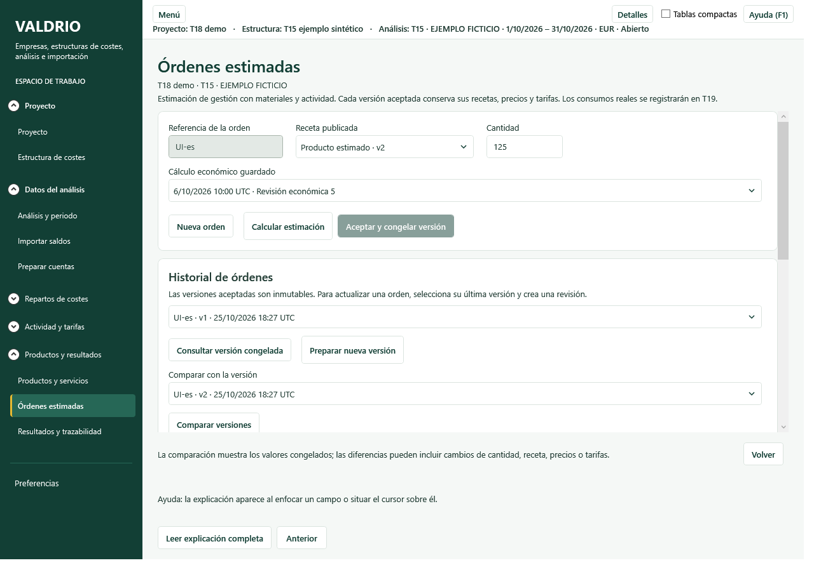
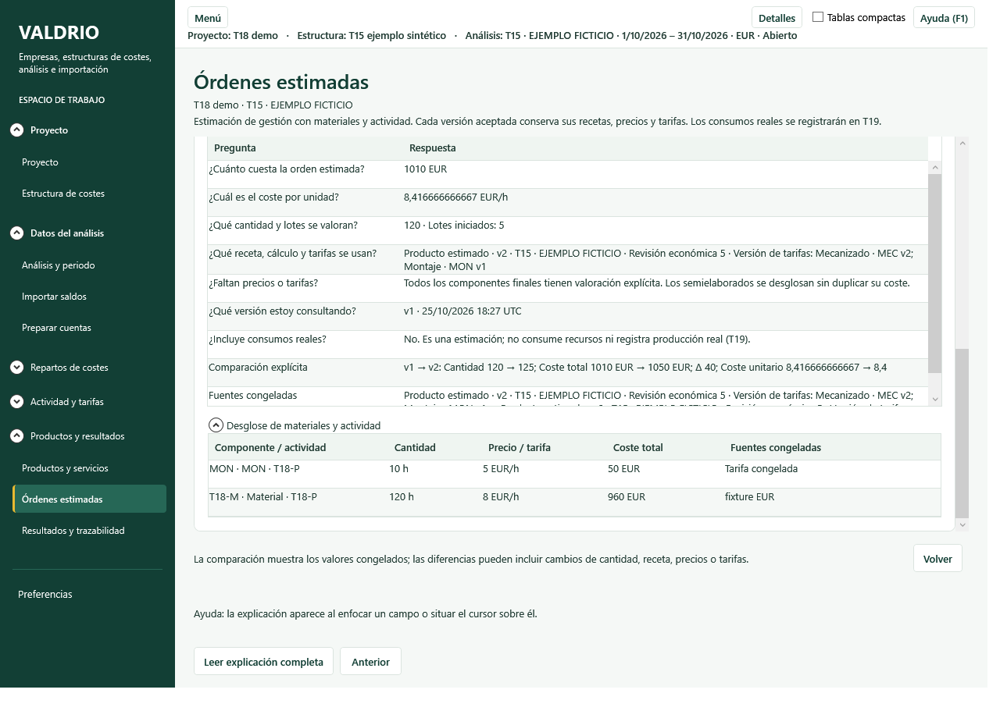

# T18 — Órdenes estimadas e historial congelado · 25/10/2026

Base: `main@dd1f6f7`, que integra el menú y los Pareto y ya está publicada en GitHub. Desarrollo en `feat/t18-frozen-estimates`, conforme a la elección del propietario de completar T18 antes de T19.

## Resultado funcional

- Página **Productos y resultados → Órdenes estimadas**, integrada en la ventana principal y disponible en español e inglés.
- Orden identificada por referencia, receta publicada, cantidad y cálculo económico guardado. Coste de materiales finales y actividad, sin sumar otra vez semielaborados ni precio del producto terminado.
- Tarifa con precisión completa, lotes iniciados, desglose y siete preguntas de analista. El caso C22 obtiene preparación 180 + proceso 240 = **420**, y **3,5 por unidad**.
- Aceptación explícita que conserva las fuentes, recetas, cantidades, precios y tarifas. Cambio posterior del catálogo o de las observaciones físicas no modifica la versión aceptada.
- Historial y revisiones con enlace a la versión anterior; comparación explícita de dos versiones de una orden. El total comparado puede variar por volumen, receta, precios o tarifas; no se presenta como desviación real.
- Bloqueo ante precios/tarifas ausentes, moneda incompatible, previsualización desactualizada, referencia duplicada, revisión concurrente, archivo de solo lectura o análisis cerrado.
- Formato SQLite 13, actualización en copia, auditoría transaccional y comprobación al reabrir. El archivo original y los recursos/repartos permanecen intactos.
- Ayuda F1 propia y 17 vistas documentadas en ambos idiomas.

## Verificación local

- Compilación de la solución: 0 errores y 0 advertencias. Publicación local del ejecutable completada.
- Regresión completa final: **776/776**, sin fallos ni omitidas, en 5 min 25 s. [Resumen verificable](t18-ordenes-20261025/validacion.json).
- Pruebas específicas finales: **15/15**, incluyendo T18 y el catálogo de ayuda. Cubren precisión C22, congelación tras cambios, reapertura, concurrencia, cancelación, reversión, auditoría alterada, solo lectura, análisis cerrado, moneda y precios ausentes, y actualización 12→13 conservando los bytes originales.
- Recorrido del binario publicado: **25/25 comprobaciones WPF**, con empresa sintética y copias desechables. ES/EN, aceptación, revisión, comparación, formato decimal, foco de teclado, salida protegida y navegación integrada; capturas a 1280×920 y 800×650.
- `python scripts/verify_help.py`: 17 vistas lógicas y 17 XAML cubiertos.
- GitHub Actions: **no ejecutado**. Gasto provocado: **0 USD**.

Las primeras ejecuciones localizaron un índice EF ausente y conexiones de prueba con pooling que impedían limpiar archivos temporales en Windows. Se corrigieron el modelo/migración y las conexiones de las pruebas. El caso de integración utiliza una empresa EUR explícita para evitar mezclar la moneda del archivo histórico con precios EUR.

Lista de [comprobaciones WPF](t18-ordenes-20261025/checks.json). Los TRX completos, el binario y las seis capturas finales se conservan en la entrega local `entregables/T18-estimaciones`.

## Límites

No se implementan consumos reales, cierres de producción ni desviaciones T19; tampoco valoración contable T32 o conversión automática de precios entre monedas. La aceptación utiliza el cálculo económico elegido y las observaciones vigentes al previsualizar, que quedan congelados juntos. Las revisiones conservan el producto y la referencia de orden.

La verificación visual descrita usa datos sintéticos; no equivale a una aceptación de negocio del propietario ni a toda la matriz de escalados DPI. La versión anterior del archivo sigue disponible cuando se actualiza una copia. La ampliación queda en su rama de desarrollo, separada del menú/Pareto ya fusionado.
